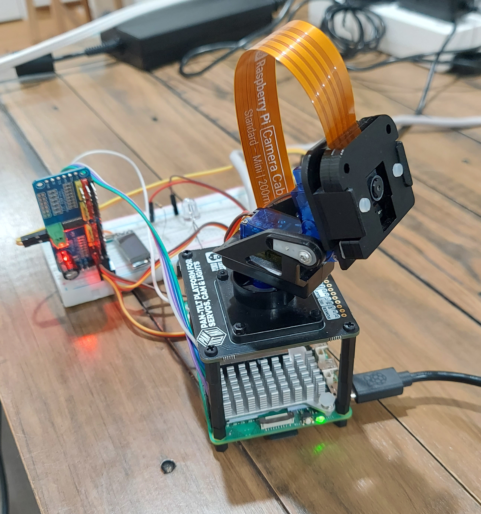
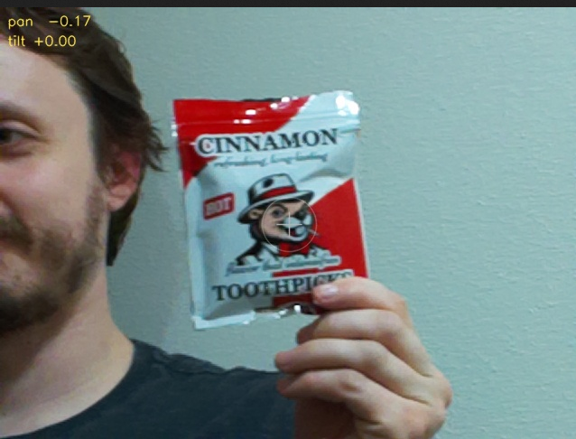

> Emitting velocity commands too slowly can lead to poor behavior in a face tracking robot.

After deploying my face-tracker model to the physical robot (a camera mounted on a pan/tilt servo kit with a Raspberry Pi), performance was not pretty. In sim, the VLA did a great job following the face it was told to. In reality, the robot would vaguely follow a face, then drift until the face was entirely out of frame, and finally get stuck in a "look up and to the left" position.


*Our intrepid adventurer!*

Initial ideas: maybe training had issues (poor sim-to-real transfer) and we needed more complex or realistic sim environments? Claude proposed we may need to tweak max acceleration or velocity -- but that didn't help at all. The hard-working LLM also suggested hardcoding a bias to move to the right in every velocity command, to offset the pan to the left (novel thinking!).

 Before starting over with new training data, I looked at the `cmd_vel` velocity messages from the ROS node. I noticed they were slow: `ros2 topic hz /cmd_vel` showed only 2 to 3 Hz. This could be an issue, since camera frames were coming through at 15 Hz.

  I moved the VLA to my laptop which could handle inference at 15 Hz. The new flow:
 ```
  Pi robot publishes camera frames and text command to laptop
  -> laptop runs inference on frame
  -> laptop publishes velocity to Pi (/cmd_vel topic)
  -> Pi moves pan/tilt servos and camera
```

Result: Solid face tracking, accurate for single and multiple faces. Even tracks a beaver drawn on a bag of toothpicks!



The robot's command here was "look at the person wearing a hat". It did track the beaver in a hat instead of me. Success! (Whether or not a beaver should be considered a "person" is beyond the scope of this article.)

## Further reading

For something completely different, see RT-2 from Google DeepMind ([paper](https://arxiv.org/abs/2307.15818); [blog post](https://deepmind.google/blog/rt-2-new-model-translates-vision-and-language-into-action/)). RT-2 is a 55B parameter model that ran at a frequency of 1 to 3 Hz, even on a fleet of TPUs. The lower frequency wasn't an issue there, perhaps due to the slow-moving object manipulation tasks of RT-2. There are doubtless other insights to be gleaned here, though!