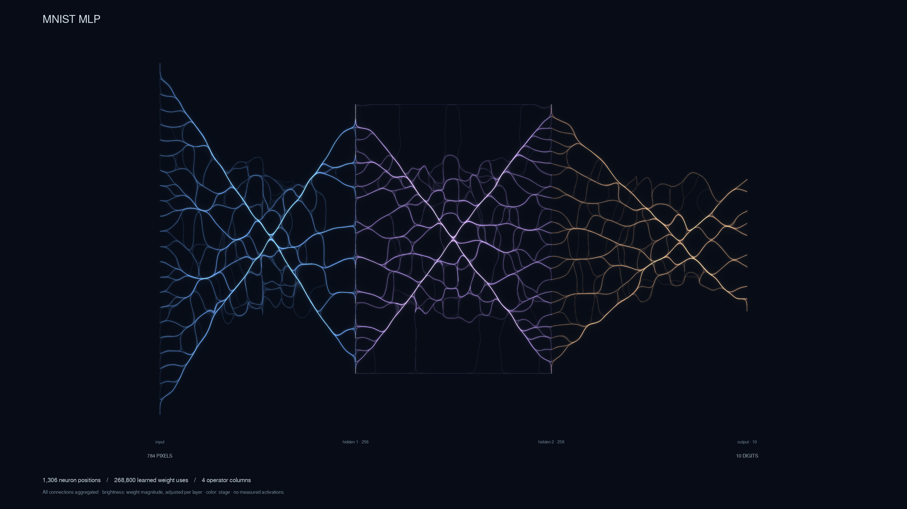
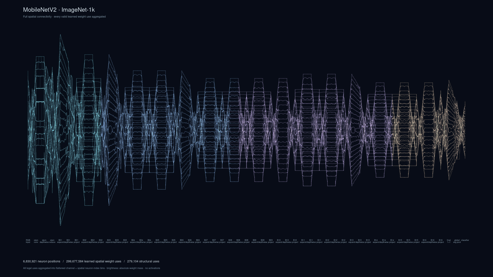
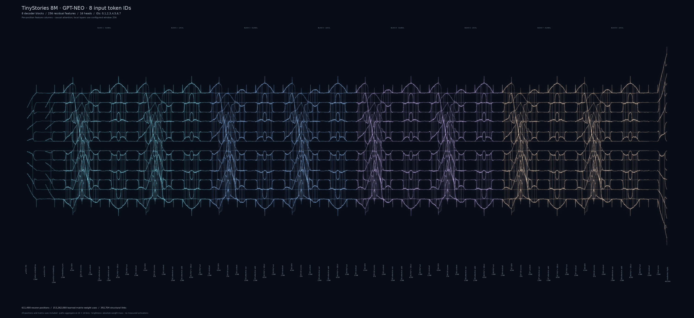
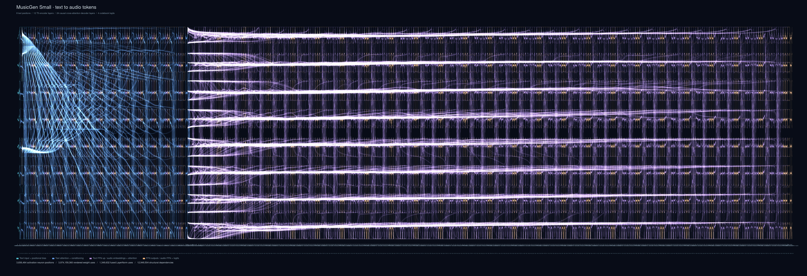

- [Gallery](#gallery)
- [What is this?](#what-is-this)
- [Source](#source)
- [Credit](#credit)

## Gallery

#### Click each image to go to a higher-resolution image for full effect.

*ResNet20 · CIFAR-10 · Image classification into 10 categories*

*MNIST MLP · Image classification into 10 digits*

*MobileNetV2 — Image classification into 1,000 categories*

*TinyStories 1M · Text to Text*

*TinyStories 8M · Text to Text*

*EnCodec · 24 kHz · Audio to Audio*

*MusicGen Small · Text to Audio*

## What is this?

These images are generated from open model weights. The X axis represents computational stages, including layers and other computational operations like [residual additions](https://en.wikipedia.org/wiki/Residual_neural_network). The Y axis represents the index of the neuron in each stage. The lines are bundles of connections between neurons in each stage (grouped together for clarity), with brightness based on the total absolute weights of the connections represented by the line.

I made this for fun, curiosity, and to appreciate the aesthetic beauty of these marvellous machines. While these representations are highly simplified (displaying weights with hundreds of dimensions onto a 2-dimensional plane, for one), I like to think of them as fingerprints of the models that, combined with much other study, could help us intuit neural networks' structures.

## Source

The code to generate these is at https://github.com/naclonts/neural-net-visual/. Try pulling other models and riffing on it!

## Credit

I was inspired to play around with this by [Julian Rogawski's nn_vis library](https://github.com/julrog/nn_vis), which generates 3D models representing neural networks.

The rendering relies on [Datashader's network bundling code](https://datashader.org/user_guide/Networks.html#edge-rendering-bundling). (Datashader is a sick library btw - check out the [homepage](https://datashader.org/index.html).)

Model cards on HuggingFace:
- MNIST MLP: [dacorvo/mnist-mlp](https://huggingface.co/dacorvo/mnist-mlp)
- ResNet20 · CIFAR-10: [sapbot/resnet20-cifar10-272k](https://huggingface.co/sapbot/resnet20-cifar10-272k)
- MobileNetV2: [google/mobilenet_v2_1.0_224](https://huggingface.co/google/mobilenet_v2_1.0_224)
- TinyStories 1M: [roneneldan/TinyStories-1M](https://huggingface.co/roneneldan/TinyStories-1M)
- TinyStories 8M: [roneneldan/TinyStories-8M](https://huggingface.co/roneneldan/TinyStories-8M)
- EnCodec · 24 kHz: [facebook/encodec_24khz](https://huggingface.co/facebook/encodec_24khz)
- MusicGen Small: [facebook/musicgen-small](https://huggingface.co/facebook/musicgen-small)

_Another fun view of MusicGen small._
