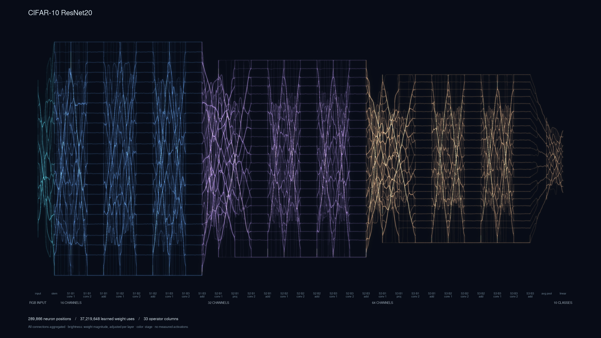
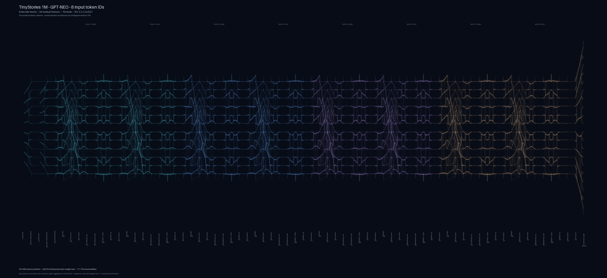
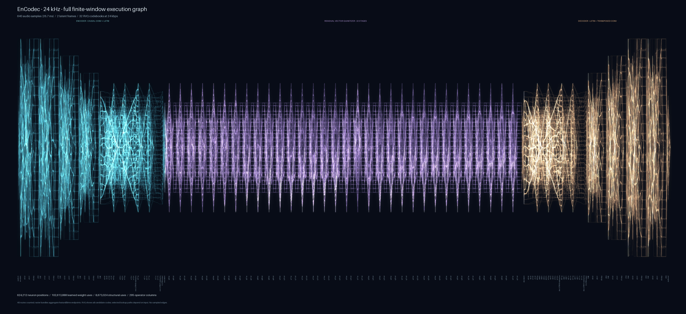
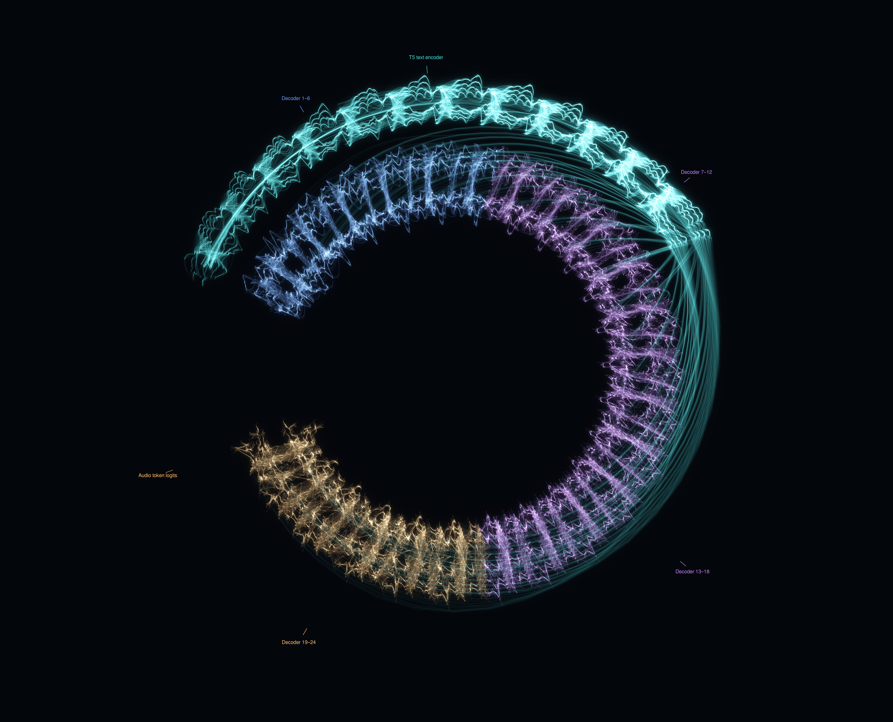

- [Gallery](#gallery)
- [What is this?](#what-is-this)
- [Source](#source)
- [Credit](#credit)

## Gallery

_Click each image to go to a higher-resolution version._

#### ResNet20 · CIFAR-10 — Image Classification

#### MNIST MLP — Image Classification

#### MobileNetV2 — Image Classification

#### TinyStories 1M — Text to Text

#### TinyStories 8M — Text to Text

#### EnCodec · 24 kHz — Audio to Audio

#### MusicGen Small — Text to Audio

#### MusicGen Small · Radial view — Text to Audio

## What is this?

## Source

## Credit

- MNIST MLP: [dacorvo/mnist-mlp](https://huggingface.co/dacorvo/mnist-mlp)
- ResNet20 · CIFAR-10: [sapbot/resnet20-cifar10-272k](https://huggingface.co/sapbot/resnet20-cifar10-272k)
- MobileNetV2: [google/mobilenet_v2_1.0_224](https://huggingface.co/google/mobilenet_v2_1.0_224)
- TinyStories 1M: [roneneldan/TinyStories-1M](https://huggingface.co/roneneldan/TinyStories-1M)
- TinyStories 8M: [roneneldan/TinyStories-8M](https://huggingface.co/roneneldan/TinyStories-8M)
- EnCodec · 24 kHz: [facebook/encodec_24khz](https://huggingface.co/facebook/encodec_24khz)
- MusicGen Small: [facebook/musicgen-small](https://huggingface.co/facebook/musicgen-small)
