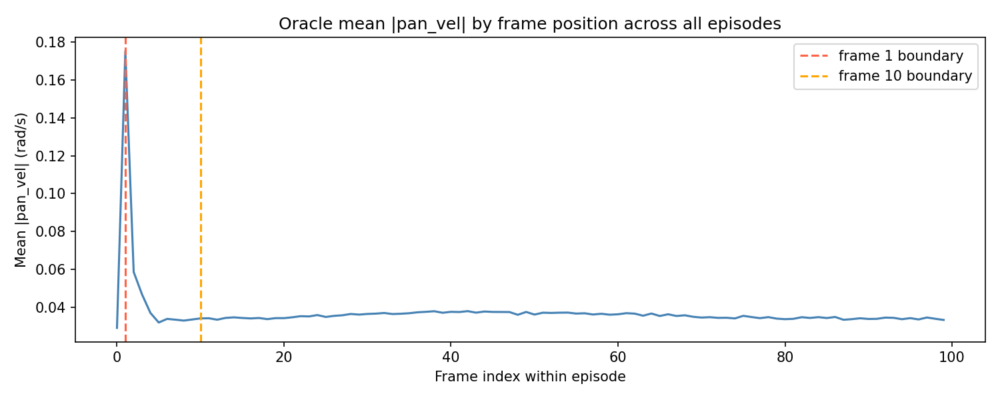

We only learn from error. The same could be said for neural networks.

I implemented a vision-language-action model trained to follow faces in its viewport, using pan/tilt servos to direct its view. I used a behavioral cloning approach: an oracle tracked the position of the face it was told to follow, and the VLA was trained to imitate the oracle's movement in each frame.

The initial sim environment consisted of slowly moving face images:

[[Oracle node tracks a face in a hyper-realistic sim environment ;) It's so... beautiful...]]

I recorded 10,000 episodes of similar scenarios. Each scenario selected from ~500 face models that were AI-generated to include specific attributes like glasses or hats. The movement patterns varied by scenario. Language command varied from "track the person" for a single face, to "track the face with glasses" and "look at the right-most person" for multiple-face scenarios.

The VLA model was ~1.5M parameter action model on top of pre-trained frozen text and video models. I started with a hyperparameter sweep over 1,500 episodes.

The results speak for themselves:

[[GIF of VLA in sim drifting semi-aimlessly around (sweep-v0.0.2-* model onnx)]]

The resulting model had an average error of about 20 degrees for basic scenarios -- in a field of view of just 60 degrees!

One issue stood out: the VLA was almost always several degrees away from its face target. However, the oracle was almost always _directly on_ its target. Only 3% of the training data's frames had an error greater than X degrees -- and exclusively during the first 3 to 5 frames of each episode. This was because at the beginning of each episode, the oracle started at a random position relative to the face. However, within a few frames, it had reached its target. From then on, it only moved slightly to keep up with the face as it moved.

_Average pan velocity of oracle per frame, where 0 is the first frame of the episode_

The result: only ~3% of the frames in the dataset were relevant to the VLA's most common situation, a face being distant from its current orientation. The other 97% of training frames reflected a state rarely seen by the VLA, where the face was in the very middle of the viewport.

How to solve this? We could scale: with 30x more simulated episodes in the dataset, we'd have 30x the initial, high-error frames!

Or... we could add error by perturbing the target throughout each episode.

I added random jumps to the target over N frames in the oracle dataset:

[[GIF of oracle following face w periodic jumps]]

I then ran another small training run of 1,500 episodes with the same hyperparameters.

The result? Average error of Y degrees. Let's see it:

[[GIF of VLA after training on data with perturbations (v0.0.3 model onnx?)]]

The lesson? VLA's learn from error, like we do. Perfect, simple training scenarios will create models which can't handle imperfect, complex reality.

